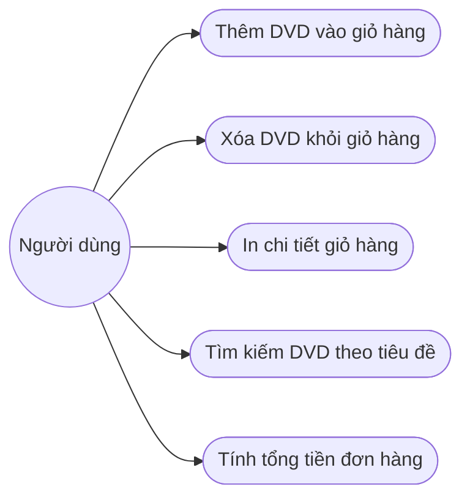

# Use Case Diagram & Đặc tả ca sử dụng AIMS-mini

## 1. Sơ đồ Use Case

## 2. Mô tả tóm tắt các ca sử dụng
- **Thêm DVD vào giỏ hàng (`add_dvd`):** Cho phép người dùng thêm đĩa DVD vào giỏ, kiểm tra giới hạn tối đa `MAX_NUMBERS_ORDERED` (20 đĩa).
- **Xóa DVD khỏi giỏ hàng (`remove_dvd`):** Xóa một đĩa DVD đang có trong giỏ hàng.
- **In chi tiết giỏ hàng (`print_cart`):** Hiển thị danh sách các đĩa đã chọn kèm thông tin chi tiết và tổng giá tiền. Nếu giỏ rỗng, thông báo `The cart is empty`.
- **Tìm kiếm DVD theo tiêu đề (`search_by_title`):** Tìm các đĩa DVD có tên chứa từ khóa tìm kiếm.
- **Tính tổng tiền đơn hàng (`total_cost`):** Tính tổng giá tiền các đĩa đang có trong giỏ hàng.
